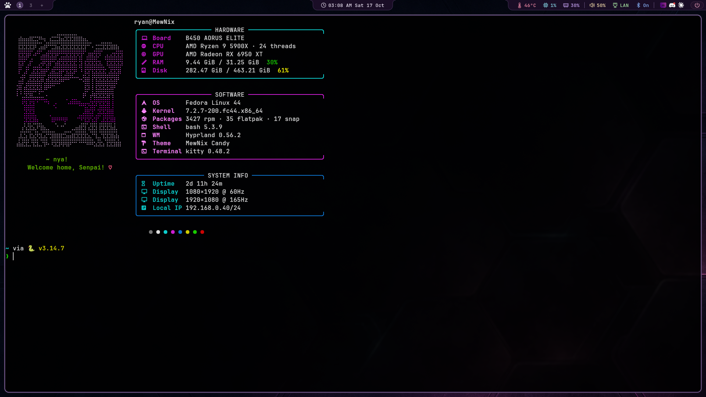
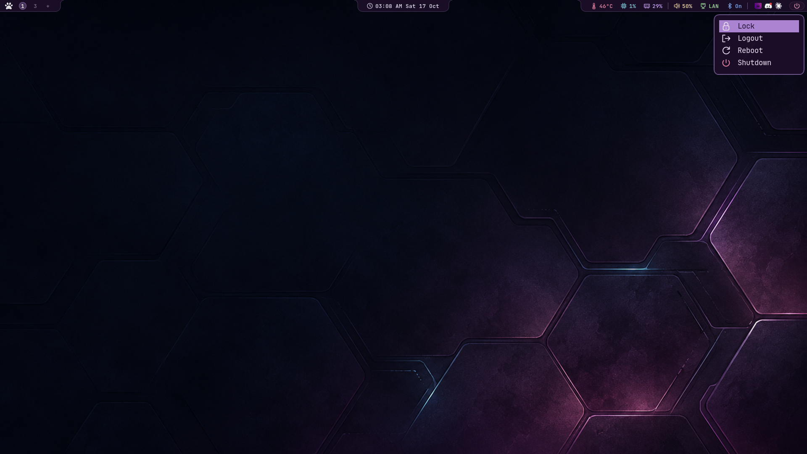
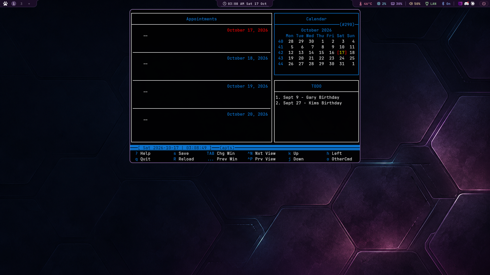
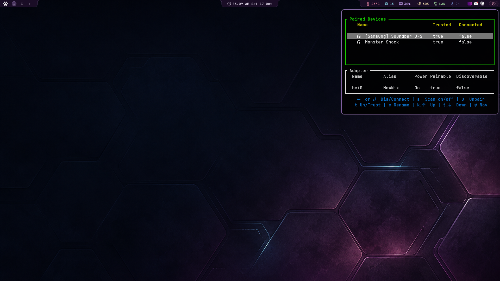
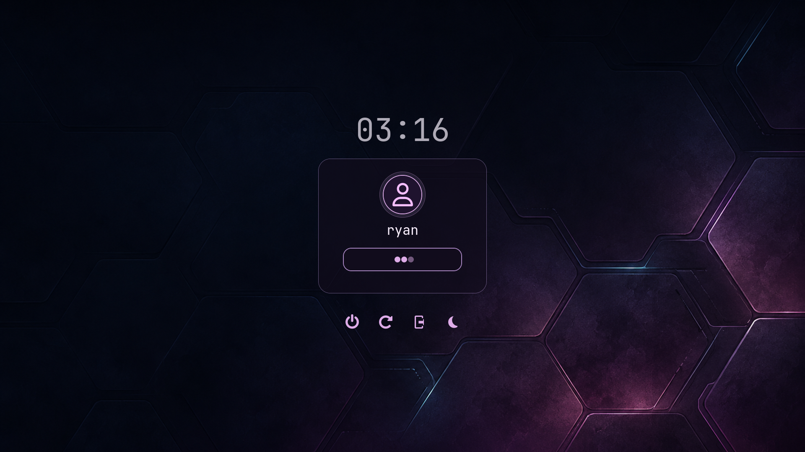

# MewNix Candy Hyprland

A purple-and-rose Hyprland rice with compact Waybar panels, matching SVG status icons, and rounded, flared edges.

## Screenshots

### Desktop and Fastfetch



### Power menu



### Desktop menu


### Floating utility windows

Bluetui, Wiremix, and Calcurse run in floating Kitty windows, with their positioning and animations defined in `hyprland.lua`. Calcurse and Bluetui are shown below.





### Application launcher


### Hyprlock



## Included

- 28px Waybar layouts for the main and secondary monitors.
- SVG icons for system stats, audio, network, Bluetooth, clock, and power.
- Matching workspace indicators, subtle underline hovers, and a rose power button.
- Hyprland, Hypridle, Hyprlock, launcher, notification, terminal-shell, and visualizer configuration.
- Shared wallpapers and the `toggle-float` helper.

Personal wallpaper collections (`Wallpaper/Sus/`, `Wallpaper/Neo/`, and `Wallpaper/Goth/`) are excluded from Git. Screenshots may show wallpapers that are not included. Update the wallpaper paths in `[dot]local/share/mewnix-hypr-themes/themes/*.theme` to images on your own machine. Wallpaper images referenced by these presets are not bundled automatically.

## Layout

`[dot]config/` represents `~/.config/`, and `[dot]local/` represents `~/.local/`. The brackets are literal directory names in this repository. Hyprland configuration is under `[dot]config/hypr/`.

These are personal configuration files, rather than an automatic installer. Review the files before copying them into your home directory. Adjust `/home/ryan` paths, monitor names (`DP-1` and `HDMI-A-1`), temperature sensor paths, and application commands for your machine. The included Hyprland configuration uses Lua.

Copy the complete Waybar directory, including `icons/` and `scripts/`; its CSS references the SVG assets. Waybar uses JetBrainsMono Nerd Font. Fuzzel provides the application launcher and power menu.

## Utility window toggles

The Waybar audio, Bluetooth, and clock buttons toggle Wiremix, Bluetui, and Calcurse in Kitty. Click once to open the utility, then click again to close its window.

The included `toggle-float` script belongs in `~/.local/bin/` and takes a window class and a launch command. It checks for an existing window with that class: if one exists, it closes it; otherwise, it runs the launch command. This lets repeated clicks toggle the utility instead of opening extra copies. The script uses `hyprctl` and `jq`.

Window rules in `[dot]config/hypr/hyprland.lua` match those Kitty window classes and control floating, size, position, and animation. For example, the `calcurse-float` rule creates a 900×600 floating window, centers it horizontally, places it 38 pixels from the top, and applies the `slide top` animation. The `toggle-float` script handles opening and closing; it does not switch windows between tiled and floating modes.


## Theme selector

Includes a MewNix adaptation of [hypr-themes](https://github.com/thenullstackdeveloper/hypr-themes), with its MIT license and source attribution. Copy both `[dot]config/` and `[dot]local/` to their corresponding home directories. The `.active` symlink is relative to the installed home-directory layout.

Run `~/.local/bin/theme` for the centered Fuzzel picker, or apply a preset directly:

```sh
~/.local/bin/theme candy
~/.local/bin/theme midnight-blue
~/.local/bin/theme silver
```

The sfav configuration includes direct theme commands. The picker previews a selection; choose “keep this theme” to save it or Escape to revert. There is no theme keyboard shortcut or application-launcher entry.

Edit `~/.local/share/mewnix-hypr-themes/themes/*.theme` for shared colors and wallpaper settings. `WALLPAPER_MAIN` targets DP-1 and `WALLPAPER_PORTRAIT` targets HDMI-A-1, for both desktop and Hyprlock. Optional `LOCK_WALLPAPER_MAIN` and `LOCK_WALLPAPER_PORTRAIT` override only the lock screen. Candy uses the midnight-plum landscape and portrait images; Midnight Blue uses the cyber-cat landscape and cyber-neon portrait images. Silver currently keeps its separate lock wallpaper pair and remembers its desktop selection through Waypaper.

Waybar continues to use `style.css`, `style_midnight_blue.css`, and `style_silver.css`, including their SVG assets. Generated color partials cover Hyprland borders, Fuzzel, Wofi, Mako, and Hyprlock. Kitty is not controlled by the selector. Existing panel shapes, red power icons, and lock-screen geometry are preserved.

The selector needs Bash, Python 3, `envsubst` (gettext), Fuzzel, Waypaper with swaybg, Waybar, Hyprland, and Mako. The Lua startup restores the selected Waybar style; Waypaper restores the saved desktop backgrounds. Wallpaper processes are detached from the launching terminal so they survive closing sfav.
