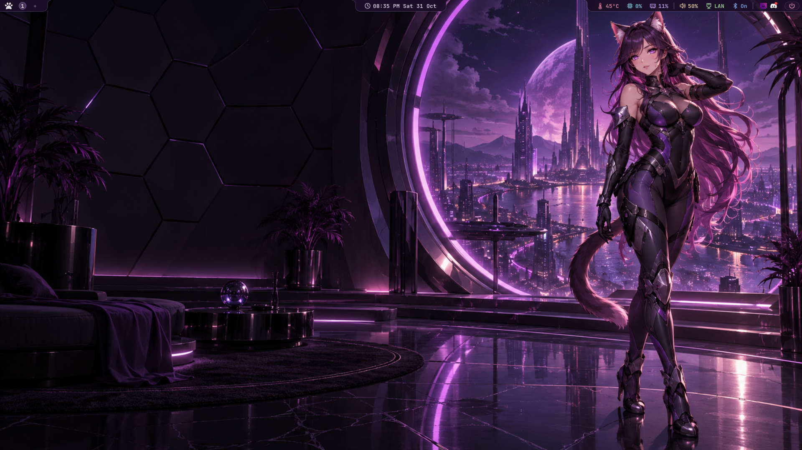
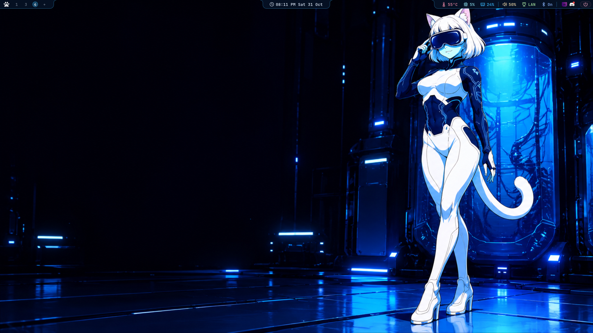
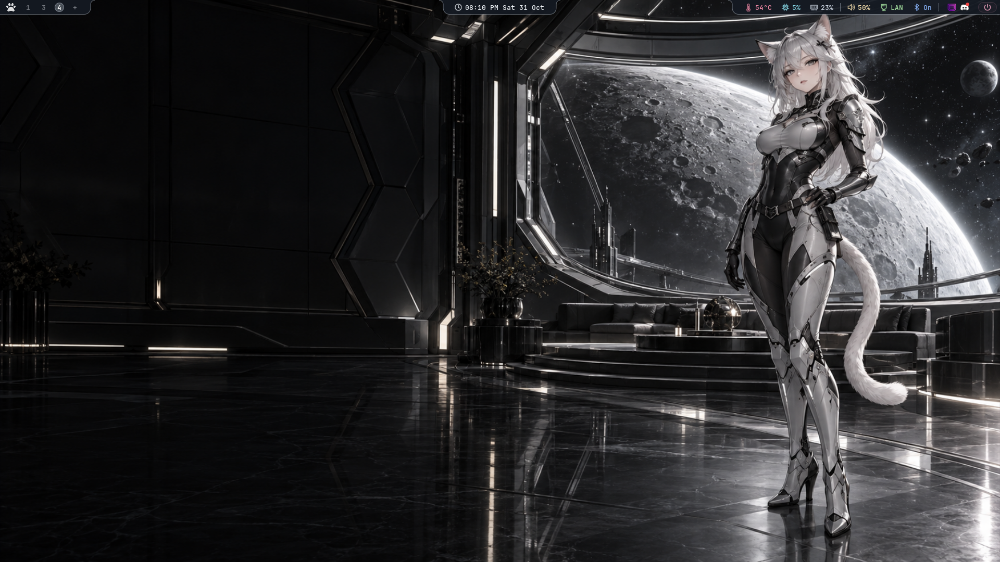
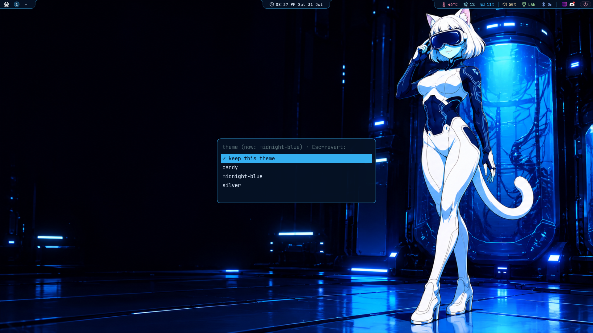
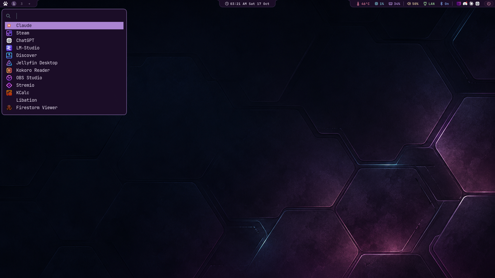
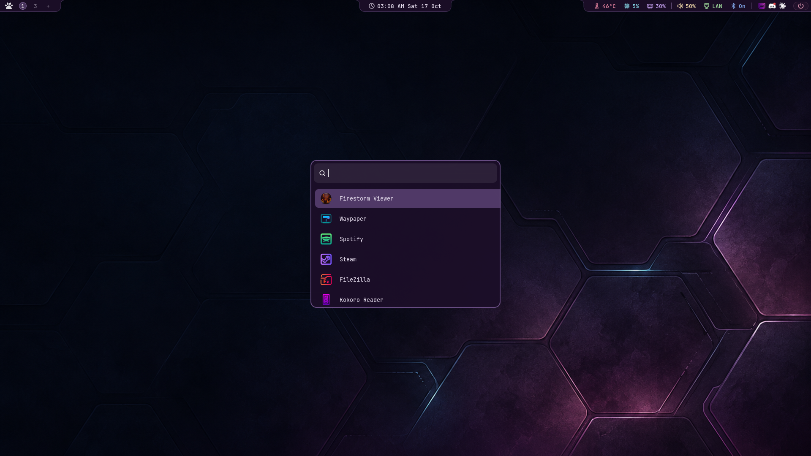

# MewNix Candy Hyprland

A Hyprland Lua desktop with three coordinated themes: **Candy**, **Midnight Blue**, and **Silver**. Compact Waybar panels, matching SVG icons, rounded edges, and a theme selector tie the desktop together across a landscape and portrait monitor.

## Themes

### Candy

Purple and rose accents with a violet observation-lounge wallpaper and an adjoining-room portrait background.



### Midnight Blue

Navy panels, cyan accents, and teal active-window borders, paired with blue cyber-themed wallpapers.



### Silver

Graphite panels and silver accents with an orbital observation-lounge wallpaper pair.



## Theme selector

This repository includes a local adaptation of [hypr-themes](https://github.com/thenullstackdeveloper/hypr-themes). It connects the upstream palette/template approach to MewNix's existing Waybar styles, Fuzzel picker, Mako notifications, and Waypaper/swaybg wallpapers. The bundled source retains the upstream MIT license and revision attribution.



Press **Super + Shift + T**, or run:

```sh
~/.local/bin/theme
```

Use the arrow keys and Enter to preview a theme. The picker reopens after applying it:

- Choose **keep this theme** to keep the selection.
- Press **Escape** to return to the theme active when the picker opened.

Apply a theme immediately, without the preview confirmation:

```sh
~/.local/bin/theme candy
~/.local/bin/theme midnight-blue
~/.local/bin/theme silver
```

The included sfav entries use these direct commands. Other commands include `theme list`, `theme current`, `theme next`, and `theme prev` when `~/.local/bin` is on your PATH.

### What changes

| Component | Theme behavior |
| --- | --- |
| Hyprland | Active-window border colors, loaded from a generated Lua module |
| Waybar | Both bars restart using the selected stylesheet and its SVG assets |
| Fuzzel and Wofi | Generated color partials update launcher colors |
| Mako | Notification colors reload while critical alerts retain their separate styling |
| Hyprlock | Generated color and wallpaper variables are used the next time the screen locks |
| Desktop wallpaper | Waypaper applies the monitor-specific images through swaybg |

Panel shapes, the rose/red power icon, and lock-screen layout stay in their existing configs. **Kitty colors are not managed by the selector.**

The selected theme is saved in `~/.config/hypr-themes/.active`. At login, `theme restore` starts both Waybars with the saved style, and `waypaper --restore` restores the desktop backgrounds. Wallpaper processes run independently of the launching terminal, so closing sfav does not stop them.

### Editing palettes and wallpapers

Edit the installed theme files:

```text
~/.local/share/mewnix-hypr-themes/themes/candy.theme
~/.local/share/mewnix-hypr-themes/themes/midnight-blue.theme
~/.local/share/mewnix-hypr-themes/themes/silver.theme
```

Each file contains the shared palette and wallpaper paths. Keep the corresponding HEX and RGB values consistent when changing colors. `BORDER_COLOR_1` and `BORDER_COLOR_2` control the active-window gradient separately from the shared accent color.

Wallpaper settings apply to **both the desktop and Hyprlock**:

```sh
# DP-1: landscape monitor
WALLPAPER_MAIN="/home/ryan/Pictures/backgrounds/gpt/candy-cat-observatory-v1.png"
# HDMI-A-1: portrait monitor
WALLPAPER_PORTRAIT="/home/ryan/Pictures/backgrounds/gpt/candy-observatory-extension-portrait.png"
```

Optional `LOCK_WALLPAPER_MAIN` and `LOCK_WALLPAPER_PORTRAIT` settings override only the lock-screen images. Using only those settings does not assign desktop wallpapers.

Reapply the theme after editing. Explicit wallpaper paths in a `.theme` file take precedence over Waypaper's remembered selection. `theme wallpaper` opens Waypaper, but to permanently change a preset's assigned images, edit its `.theme` file.

Waybar styling remains in these separate files:

| Theme | Stylesheet under `~/.config/waybar/` |
| --- | --- |
| Candy | `style.css` |
| Midnight Blue | `style_midnight_blue.css` |
| Silver | `style_silver.css` |

The selector regenerates `mewnix-colors` partials, `hypr/modules/theme.lua`, `hypr/hyprlock-theme.conf`, and `hypr/hyprlock-wallpapers.conf`. Edit the palettes or templates rather than those generated files.

### Dependencies and updates

The selector uses Bash, Python 3, `envsubst` from gettext, Fuzzel, Waybar, Hyprland, Mako, and Waypaper with swaybg. Hyprlock and Wofi use the generated styling when launched. The desktop also uses JetBrainsMono Nerd Font and Symbols Nerd Font.

This is a **bundled local adaptation**, not an automatically updated upstream installation. System updates do not update it. Changes from the original hypr-themes project need to be reviewed and merged into this copy. There is no automatic installer or uninstaller for the adaptation.

## More screenshots

These screenshots show the supporting tools and layout; some use the earlier abstract wallpaper.

### Fastfetch


### Fuzzel application menu



### Wofi application launcher



### Power menu


### Hyprlock


## Repository layout and setup

`[dot]config/` represents `~/.config/`, and `[dot]local/` represents `~/.local/`. The brackets are literal directory names in this repository.

| Location in this repository | Contents |
| --- | --- |
| `[dot]config/hypr/` | Hyprland Lua configuration, Hypridle, Hyprlock, and desktop scripts |
| `[dot]config/waybar/` | Main and secondary bar configs, three stylesheets, SVG icons, and scripts |
| `[dot]config/hypr-themes/` | Selector configuration and saved-theme link |
| `[dot]config/waypaper/` | Wallpaper backend and monitor settings |
| `[dot]local/bin/theme` | Theme command wrapper |
| `[dot]local/share/mewnix-hypr-themes/` | Selector implementation, palettes, templates, and upstream license |
| `Wallpaper/` | Included wallpaper collection |
| `Docs/` | Desktop and application screenshots |

These are personal configuration files. Review them before copying them into your home directory, and back up your existing configuration. Copy both dot directories to their corresponding home locations; the `.active` symlink targets the installed home-directory layout. Preserve executable permissions on the scripts and put `~/.local/bin` on your PATH.

Adjust `/home/ryan` paths, monitor names (`DP-1` and `HDMI-A-1`), sensor paths, and application commands for your machine. The monitor mapping for theme wallpapers is also defined in `lib/runtime.py` inside the selector directory. Copy the complete Waybar directory, including `icons/` and `scripts/`, because its stylesheets reference those assets.

Personal wallpaper collections (`Wallpaper/Sus/`, `Wallpaper/Neo/`, and `Wallpaper/Goth/`) are excluded from Git. Screenshots may show images that are not included. Place your chosen images at the configured paths or update the `.theme` files; the selector does not download wallpaper images.

## Utility window toggles

The Waybar audio, Bluetooth, and clock buttons toggle Wiremix, Bluetui, and Calcurse in Kitty. Click once to open the utility, then click again to close its window.

The included `toggle-float` helper belongs in `~/.local/bin/` and takes a window class and a launch command. It uses `hyprctl` and `jq` to find an existing window, closing it if present or launching the utility otherwise. Hyprland's window rules control the floating placement and size; the helper toggles the utility window's presence, not its tiled/floating state.
